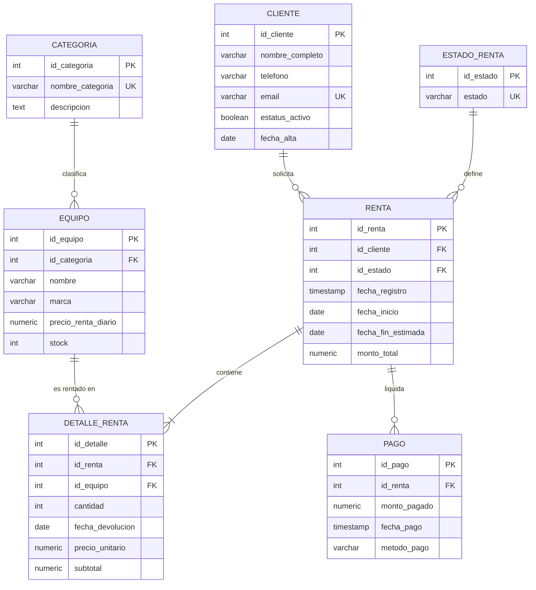

# Evidencia técnica

## 1. Modelo relacional

```
CATEGORIA (id_categoria PK, nombre_categoria UK, descripcion)

CLIENTE (id_cliente PK, nombre_completo, telefono, email UK,
         estatus_activo, fecha_alta)

ESTADO_RENTA (id_estado PK, estado UK)

EQUIPO (id_equipo PK, id_categoria FK -> CATEGORIA, nombre, marca,
        precio_renta_diario, stock, UK(nombre, marca))

RENTA (id_renta PK, id_cliente FK -> CLIENTE, id_estado FK -> ESTADO_RENTA,
       fecha_registro, fecha_inicio, fecha_fin_estimada, monto_total)

DETALLE_RENTA (id_detalle PK, id_renta FK -> RENTA, id_equipo FK -> EQUIPO,
               cantidad, fecha_devolucion, precio_unitario, subtotal,
               UK(id_renta, id_equipo))

PAGO (id_pago PK, id_renta FK -> RENTA, monto_pagado, fecha_pago, metodo_pago)
```

**PK** = llave primaria · **FK** = llave foránea · **UK** = valor único

### Cardinalidades

| Relación | Cardinalidad | Implementación |
|---|---|---|
| CATEGORIA → EQUIPO | 1 : N | `equipo.id_categoria` |
| CLIENTE → RENTA | 1 : N | `renta.id_cliente` |
| ESTADO_RENTA → RENTA | 1 : N | `renta.id_estado` |
| **RENTA ↔ EQUIPO** | **N : M** | **tabla intermedia `DETALLE_RENTA`** |
| RENTA → PAGO | 1 : N | `pago.id_renta` |

La N:M se resuelve con `DETALLE_RENTA`, que además guarda los atributos
propios de la relación: **cantidad**, **fecha de devolución**, **precio
unitario** y **subtotal**.

---

## 2. Diagrama entidad-relación

Código Mermaid (se renderiza en <https://mermaid.live>, GitHub, Notion o VS Code
con la extensión *Markdown Preview Mermaid*; desde mermaid.live se exporta PNG
para el documento):



---

## 3. Restricciones implementadas

| Restricción | Dónde | Qué impide |
|---|---|---|
| `CHECK (precio_renta_diario >= 0)` | EQUIPO | Precios negativos |
| `CHECK (stock >= 0)` | EQUIPO | Stock negativo |
| `CHECK (fecha_fin_estimada >= fecha_inicio)` | RENTA | Entregar antes de iniciar |
| `CHECK (cantidad > 0)` | DETALLE_RENTA | Renglones en cero |
| `UNIQUE (id_renta, id_equipo)` | DETALLE_RENTA | Duplicar el mismo equipo en una renta |
| `CHECK (metodo_pago IN (...))` | PAGO | Métodos de pago inválidos |
| `UNIQUE` en email y nombres | CLIENTE, CATEGORIA | Duplicados |
| Trigger `trg_detalle_monto` | DETALLE_RENTA | Que `monto_total` no cuadre |
| Trigger `trg_detalle_fecha_devolucion` | DETALLE_RENTA | Devolver antes de rentar |
| Vista `v_equipo_disponible` | — | Que el stock se desincronice |

---

## 4. Tres expresiones de álgebra relacional

Notación: **σ** selección · **π** proyección · **⋈** reunión natural ·
**γ** agrupación · **⟕** reunión externa izquierda · **ρ** renombrado.

### 4.1 Equipos pendientes de devolución (Consulta 1)

> Cliente, teléfono, equipo y cantidad de todo lo que aún no se devuelve.

```
π_(nombre_completo, telefono, nombre, cantidad, fecha_inicio) (
    σ_(fecha_devolucion IS NULL) (
        DETALLE_RENTA ⋈ RENTA ⋈ CLIENTE ⋈ EQUIPO
    )
)
```

### 4.2 Ingresos por categoría (Consulta 3)

> Total facturado y piezas rentadas, agrupados por categoría.

```
γ_(nombre_categoria ; SUM(subtotal) → ingresos, SUM(cantidad) → articulos) (
    CATEGORIA ⋈ EQUIPO ⋈ DETALLE_RENTA
)
```

### 4.3 Rentas por estado (Consulta 6)

> Cuántas rentas hay en cada estado, incluyendo los estados sin rentas.

```
γ_(estado ; COUNT(id_renta) → total_rentas) (
    ESTADO_RENTA ⟕ RENTA
)
```

### 4.4 Extra — historial de un cliente (Consulta 2)

> Renglones de las rentas finalizadas del cliente con `id_cliente = 3`.

```
π_(id_renta, nombre, cantidad, subtotal, fecha_devolucion) (
    σ_(id_cliente = 3 ∧ estado = 'Finalizada') (
        RENTA ⋈ DETALLE_RENTA ⋈ EQUIPO ⋈ ESTADO_RENTA
    )
)
```

---

## 5. Correspondencia consulta SQL ↔ álgebra relacional

| # | Consulta SQL | Operadores usados |
|---|---|---|
| 1 | Pendientes de devolución | σ, π, ⋈ |
| 2 | Historial de un cliente | σ, π, ⋈ |
| 3 | Ingresos por categoría | γ, ⋈ |
| 4 | Clientes activos | σ, π |
| 5 | Inventario bajo | σ, π |
| 6 | Rentas por estado | γ, ⟕ |
| 7 | Detalle de una renta | σ, π, ⋈ |
| 8 | Total cobrado | γ |
