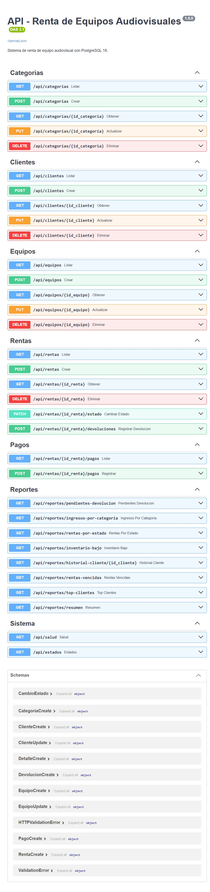

# Manual de usuario — RentaVisual

**Sistema de renta de equipos audiovisuales**
Versión 1.0 · Noviembre 2026

---

## Índice

1. [¿Qué es el sistema?](#1-qué-es-el-sistema)
2. [Requisitos](#2-requisitos)
3. [Instalación paso a paso](#3-instalación-paso-a-paso)
4. [Cómo iniciar el sistema](#4-cómo-iniciar-el-sistema)
5. [Pantalla principal](#5-pantalla-principal)
6. [Registrar una renta](#6-registrar-una-renta)
7. [Consultar los reportes](#7-consultar-los-reportes)
8. [Registrar una devolución](#8-registrar-una-devolución)
9. [Solución de problemas](#9-solución-de-problemas)
10. [Glosario](#10-glosario)

---

## 1. ¿Qué es el sistema?

RentaVisual administra el inventario de equipo audiovisual de una empresa de
rentas y controla:

- el **catálogo** de equipos por categoría (audio, video, iluminación),
- los **clientes** que rentan,
- las **rentas**, que pueden incluir varios equipos a la vez,
- la **cantidad** y la **fecha de devolución** de cada equipo rentado,
- los **pagos** y los **reportes** de ingresos.

El sistema funciona en el navegador y guarda todo en una base de datos
PostgreSQL. No requiere internet.

---

## 2. Requisitos

| Componente | Versión | Para qué |
|---|---|---|
| PostgreSQL | 18.x | Guardar los datos |
| Python | 3.11 o superior | Ejecutar el servidor |
| Navegador | Chrome, Edge o Firefox actualizado | Ver el sitio |

> El proyecto ya incluye el código del servidor y del sitio. Lo único que hay
> que preparar es la base de datos.

---

## 3. Instalación paso a paso

Esta instalación se hace **una sola vez**.

### 3.1 Abrir PowerShell en la carpeta del proyecto

1. Abre el Explorador de Windows y entra a la carpeta del proyecto.
2. Haz clic en la barra de direcciones, escribe `powershell` y presiona **Enter**.

Se abre una ventana azul ubicada ya en la carpeta correcta.

> **Importante:** si escribes la ruta a mano:
> `cd "C:\Users\casta\OneDrive\Documents\base_datos"`
> (las comillas solo son necesarias si la ruta tiene espacios).

### 3.2 Habilitar la ejecución de scripts (solo la primera vez)

Si al activar el entorno aparece el mensaje *"la ejecución de scripts está
deshabilitada en este sistema"*, ejecuta:

```powershell
Set-ExecutionPolicy -Scope CurrentUser -ExecutionPolicy RemoteSigned
```

Responde `S` (Sí) si lo pide. Este cambio solo afecta a tu usuario y es
reversible.

### 3.3 Entrar a la carpeta del backend y activar el entorno

```powershell
cd backend
.\.venv\Scripts\Activate.ps1
```

Sabrás que funcionó porque el inicio de la línea cambia a `(.venv)`.

### 3.4 Crear la base de datos

```powershell
python scripts\crear_bd.py
```

El programa pide la **contraseña del usuario `postgres`** (la que pusiste al
instalar PostgreSQL; al escribir no se ven los caracteres) y después muestra:

```
Base 'renta_equipos' creada.
Cargando estructura y datos:
  -> 01_esquema.sql ... OK
  -> 02_datos.sql ... OK

Listo: 4 equipos, 2 rentas.
Disponibilidad calculada por la vista:
   [1] Microfono Inalambrico         stock=10  disponible=8
   [2] Bocina Activa 15 pulgadas     stock=4   disponible=4
   [3] Proyector 4K                  stock=2   disponible=1
   [4] Kit de Luces LED              stock=6   disponible=6
```

La instalación terminó. La próxima vez ya no hace falta repetir estos pasos.

---

## 4. Cómo iniciar el sistema

Cada vez que quieras usar el sitio:

```powershell
cd backend
.\.venv\Scripts\Activate.ps1
uvicorn app.main:app --reload
```

Verás algo así:

```
INFO:     Uvicorn running on http://127.0.0.1:8000
INFO:     Application startup complete.
```

Abre el navegador en **http://localhost:8000**

Para **detener** el servidor: vuelve a la ventana de PowerShell y presiona
`Ctrl + C`.

> Deja la ventana de PowerShell abierta mientras uses el sitio. Si la cierras,
> el sistema deja de funcionar.

---

## 5. Pantalla principal


La pantalla se divide en tres partes:

### 5.1 Barra de navegación (arriba)

Contiene el logotipo **RentaVisual** y los accesos a las secciones: Inicio,
Clientes, Equipos, Rentas y Reportes.

### 5.2 Tarjetas de resumen

| Tarjeta | Qué muestra |
|---|---|
| **Clientes activos** | Clientes que no han sido dados de baja |
| **Rentas activas** | Contratos que están en curso ahora mismo |
| **Equipos fuera** | Renglones de equipo que aún no se devuelven |
| **Ingresos cobrados** | Suma de todos los pagos registrados |

Estas cifras se calculan en el momento, no están guardadas: si registras una
renta, cambian de inmediato.

### 5.3 Tabla de inventario

| Columna | Significado |
|---|---|
| **Equipo** | Nombre del artículo |
| **Marca** | Fabricante |
| **Categoría** | Audio, Video o Iluminación |
| **Precio/día** | Tarifa de renta por día |
| **Stock** | Unidades totales que posee la empresa |
| **Disponible** | Unidades libres **ahora** |

El número verde de **Disponible** es la diferencia entre el stock y lo que está
rentado sin devolver. Si llega a cero, el equipo no se puede rentar hasta que
regrese.

---

## 6. Registrar una renta

Mientras las pantallas del sitio terminan de desarrollarse, el proceso se
registra desde la documentación interactiva de la API.

### 6.1 Abrir la documentación

Entra a **http://localhost:8000/docs**



### 6.2 Pasos

1. Despliega **`POST /api/rentas`** y pulsa **Try it out**.
2. Reemplaza el contenido por los datos de la renta:

```json
{
  "id_cliente": 2,
  "fecha_inicio": "2026-11-03",
  "fecha_fin_estimada": "2026-11-06",
  "detalles": [
    { "id_equipo": 1, "cantidad": 2 },
    { "id_equipo": 3, "cantidad": 1 }
  ]
}
```

| Campo | Significado |
|---|---|
| `id_cliente` | Cliente que renta |
| `fecha_inicio` | Día de entrega (formato AAAA-MM-DD) |
| `fecha_fin_estimada` | Día de devolución pactado |
| `detalles` | Lista de equipos y cantidades |

3. Pulsa **Execute**.

### 6.3 Qué hace el sistema

- Verifica que el cliente exista y esté activo.
- Revisa que haya unidades disponibles de **cada** equipo.
- Toma el precio de la base de datos (nunca del formulario).
- Calcula `subtotal = cantidad × precio por día × días`.
- Guarda la renta y todos sus renglones **de una sola vez**.

Si algo falla, responde con un mensaje como:

```json
{
  "detail": "Stock insuficiente de 'Proyector 4K': se pidieron 3 y solo hay 1 disponibles"
}
```

y **no guarda nada**. Esto evita rentas a medias.

### 6.4 Resultado

La respuesta (código `201`) incluye el folio asignado, el total calculado y el
detalle. A partir de ese momento el equipo aparece descontado en la columna
**Disponible**.

---

## 7. Consultar los reportes

Los reportes se consultan en **http://localhost:8000/docs**, sección
**Reportes**.

| Reporte | Ruta | Para qué sirve |
|---|---|---|
| Pendientes de devolución | `GET /api/reportes/pendientes-devolucion` | Saber qué equipo no ha regresado y a quién reclamarle |
| Rentas vencidas | `GET /api/reportes/rentas-vencidas` | Contratos pasados de fecha con equipo aún fuera |
| Ingresos por categoría | `GET /api/reportes/ingresos-por-categoria` | Qué línea de producto deja más dinero |
| Rentas por estado | `GET /api/reportes/rentas-por-estado` | Cuántas reservadas, activas, finalizadas y canceladas hay |
| Inventario bajo | `GET /api/reportes/inventario-bajo` | Equipos con pocas unidades en total |
| Historial de un cliente | `GET /api/reportes/historial-cliente/{id}` | Todo lo que ha rentado una persona |
| Top clientes | `GET /api/reportes/top-clientes` | Quién renta más y cuánto ha gastado |

Para usar uno: despliégalo → **Try it out** → **Execute** → revisa el
**Response body**.

---

## 8. Registrar una devolución

1. En `GET /api/rentas` localiza el folio (`id_renta`) que deseas cerrar.
2. Despliega **`POST /api/rentas/{id_renta}/devoluciones`**, pulsa
   **Try it out**.
3. Escribe el folio en el campo `id_renta`.
4. En el cuerpo, deja `{}` para devolver **todo** lo pendiente, o indica las
   líneas concretas:

```json
{ "id_detalles": [1, 2] }
```

5. Pulsa **Execute**.

El sistema guarda la fecha de devolución, repone las unidades al inventario y,
si ya no queda nada pendiente, cambia la renta a estado **Finalizada**
automáticamente.

---

## 9. Solución de problemas

| Mensaje o síntoma | Causa | Solución |
|---|---|---|
| *"la ejecución de scripts está deshabilitada"* | Política de PowerShell | `Set-ExecutionPolicy -Scope CurrentUser RemoteSigned` |
| La ventana de PowerShell se cierra al instante | Se ejecutó `Activate.ps1` con doble clic; eso abre una sesión temporal | Abre PowerShell **dentro** de la carpeta y escribe `.\\.venv\\Scripts\\Activate.ps1` |
| *"No se reconoce el término 'uvicorn'"* | El entorno virtual no está activo | Repite `.\.venv\Scripts\Activate.ps1`; la línea debe empezar con `(.venv)` |
| *"No module named app"* | `uvicorn` se ejecutó fuera de `backend` | Entra a `backend` antes de ejecutarlo |
| *"connection refused"* | PostgreSQL no está corriendo | Abre **Servicios** de Windows y verifica `postgresql-x64-18` |
| *"password authentication failed"* | Contraseña incorrecta | Vuelve a ejecutar `python scripts\crear_bd.py` |
| *"database renta_equipos does not exist"* | Falta crear la base | `python scripts\crear_bd.py` |
| El sitio muestra "No se pudo conectar con el servidor" | El servidor está detenido | Ejecuta `uvicorn app.main:app --reload` |
| *"Only one usage of each socket address"* | El puerto 8000 ya está ocupado (otro servidor abierto) | Cierra la otra ventana o usa `--port 8001` |
| Página en blanco | Ruta equivocada | Verifica que sea `http://localhost:8000` |

---

## 10. Glosario

- **API**: puerta de entrada al sistema; recibe peticiones y devuelve datos.
- **Backend**: programa en Python que valida las reglas y habla con la base.
- **Frontend**: lo que se ve en el navegador.
- **Endpoint**: cada dirección de la API (`/api/rentas`, `/api/equipos`…).
- **Folio**: número de renta (`id_renta`).
- **Stock**: unidades totales de un equipo.
- **Disponible**: unidades libres en este momento.
- **JSON**: formato de texto con el que el navegador y el servidor intercambian datos.
- **Trigger**: regla que la base ejecuta sola (por ejemplo, recalcular el total).
- **Vista**: consulta guardada que se usa como si fuera una tabla.

---

*Fin del manual.*
