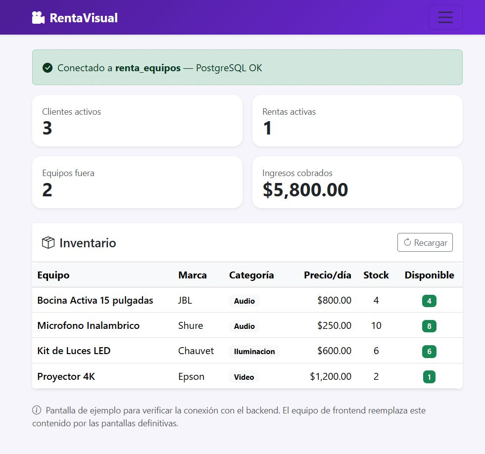

# Manual de usuario — RentaVisual

**Sistema de renta de equipos audiovisuales**
Versión 1.0 · Noviembre 2026

---

## Índice

1. [¿Qué es el sistema?](#1-qué-es-el-sistema)
2. [Requisitos](#2-requisitos)
3. [Instalación paso a paso](#3-instalación-paso-a-paso)
4. [Cómo iniciar el sistema](#4-cómo-iniciar-el-sistema)
5. [Iniciar sesión y roles](#5-iniciar-sesión-y-roles)
6. [Recorrido por el sitio (administrador)](#6-recorrido-por-el-sitio-administrador)
7. [Portal del cliente](#7-portal-del-cliente)
8. [Registrar una renta](#8-registrar-una-renta)
9. [Aprobar o rechazar solicitudes](#9-aprobar-o-rechazar-solicitudes)
10. [Cobrar una renta](#10-cobrar-una-renta)
11. [Devolver los equipos](#11-devolver-los-equipos)
12. [Consultar los reportes](#12-consultar-los-reportes)
13. [Solución de problemas](#13-solución-de-problemas)
14. [Glosario](#14-glosario)

---

## 1. ¿Qué es el sistema?

RentaVisual administra el inventario de equipo audiovisual de una empresa de
rentas y controla:

- el **catálogo** de equipos por categoría (audio, video, iluminación),
- los **clientes** que rentan,
- las **rentas**, que pueden incluir varios equipos a la vez,
- la **cantidad** y la **fecha de devolución** de cada equipo rentado,
- los **pagos** y los **reportes** de ingresos.

El sistema funciona en el navegador y guarda todo en una base de datos
PostgreSQL. No requiere internet.

Tiene **dos tipos de usuario**:

- **Administrador**: opera todo el negocio (clientes, inventario, rentas,
  reportes, solicitudes y bitácora).
- **Cliente**: entra a un portal para ver el catálogo, pedir equipos y seguir
  sus propias solicitudes.

---

## 2. Requisitos

| Componente | Versión | Para qué |
|---|---|---|
| PostgreSQL | 18.x | Guardar los datos |
| Python | 3.11 o superior | Ejecutar el servidor |
| Navegador | Chrome, Edge o Firefox actualizado | Ver el sitio |

> El proyecto ya incluye el código del servidor y del sitio. Lo único que hay
> que preparar es la base de datos.

---

## 3. Instalación paso a paso

Esta instalación se hace **una sola vez**.

### 3.1 Abrir PowerShell en la carpeta del proyecto

1. Abre el Explorador de Windows y entra a la carpeta del proyecto.
2. Haz clic en la barra de direcciones, escribe `powershell` y presiona **Enter**.

Se abre una ventana azul ubicada ya en la carpeta correcta.

> **Importante:** si escribes la ruta a mano:
> `cd "C:\Users\casta\OneDrive\Documents\base_datos"`
> (las comillas solo son necesarias si la ruta tiene espacios).

### 3.2 Habilitar la ejecución de scripts (solo la primera vez)

Si al activar el entorno aparece el mensaje *"la ejecución de scripts está
deshabilitada en este sistema"*, ejecuta:

```powershell
Set-ExecutionPolicy -Scope CurrentUser -ExecutionPolicy RemoteSigned
```

Responde `S` (Sí) si lo pide. Este cambio solo afecta a tu usuario y es
reversible.

### 3.3 Entrar a la carpeta del backend y activar el entorno

```powershell
cd backend
.\.venv\Scripts\Activate.ps1
```

Sabrás que funcionó porque el inicio de la línea cambia a `(.venv)`.

### 3.4 Crear la base de datos

```powershell
python scripts\crear_bd.py
```

El programa pide la **contraseña del usuario `postgres`** (la que pusiste al
instalar PostgreSQL; al escribir no se ven los caracteres) y después muestra:

```
Base 'renta_equipos' creada.
Cargando estructura y datos:
  -> 01_esquema.sql ... OK
  -> 02_datos.sql ... OK

Listo: 4 equipos, 2 rentas.
Disponibilidad calculada por la vista:
   [1] Microfono Inalambrico         stock=10  disponible=8
   [2] Bocina Activa 15 pulgadas     stock=4   disponible=4
   [3] Proyector 4K                  stock=2   disponible=1
   [4] Kit de Luces LED              stock=6   disponible=6
```

La instalación terminó. La próxima vez ya no hace falta repetir estos pasos.

---

## 4. Cómo iniciar el sistema

Cada vez que quieras usar el sitio:

```powershell
cd backend
.\.venv\Scripts\Activate.ps1
uvicorn app.main:app --reload
```

Verás algo así:

```
INFO:     Uvicorn running on http://127.0.0.1:8000
INFO:     Application startup complete.
```

Abre el navegador en **http://localhost:8000**

Para **detener** el servidor: vuelve a la ventana de PowerShell y presiona
`Ctrl + C`.

> Deja la ventana de PowerShell abierta mientras uses el sitio. Si la cierras,
> el sistema deja de funcionar.

---

## 5. Iniciar sesión y roles

Al abrir **http://localhost:8000** el sistema pide iniciar sesión.



### 5.1 Entrar con una cuenta

1. Escribe tu **correo** y **contraseña**.
2. Pulsa **Entrar**.

El sistema decide a dónde llevarte según tu rol:

| Rol | Pantalla inicial | Ve en el menú |
|---|---|---|
| Administrador | Panel general | Inicio, Solicitudes, Clientes, Equipos, Rentas, Reportes, Actividad y API |
| Cliente | Portal del cliente | Catálogo y Mis solicitudes |

Las cuentas de demostración son:

| Rol | Correo | Contraseña |
|---|---|---|
| Administrador | `admin@rentavisual.mx` | `Admin123!` |
| Cliente | `luis@rentavisual.mx` | `Cliente123!` |

### 5.2 Crear una cuenta de cliente

En la misma pantalla, pestaña **Crear cuenta**, un cliente nuevo puede
registrarse con su nombre, correo, teléfono y una contraseña de al menos 8
caracteres. Al terminar entra directo a su portal.

> Si el correo ya pertenece a un cliente que la empresa tenía registrado, el
> registro se rechaza: pide al administrador que te otorgue acceso desde
> **Clientes**. Así nadie se adueña del historial de otra persona.

### 5.3 Cambiar la contraseña y cerrar sesión

En la esquina superior derecha, el menú con tu nombre tiene **Cambiar
contraseña** y **Cerrar sesión**. Al cerrar, el sistema vuelve al login y borra
la cookie de sesión.

### 5.4 Si olvidas la contraseña

El cliente debe pedir al administrador que vuelva a guardar su acceso desde
**Clientes → llave**. El administrador puede asignar una contraseña nueva sin
perder el historial.

---

## 6. Recorrido por el sitio (administrador)


La barra superior está siempre visible y lleva a las secciones del sistema. A la
derecha está el acceso **API**, que abre la documentación técnica (Swagger); ese
enlace es para el equipo de desarrollo, no para el usuario final. El cliente no
ve ese enlace.

### 6.1 Panel general (Inicio)

Es la primera pantalla y resume el estado del negocio:

| Tarjeta | Qué muestra |
|---|---|
| **Clientes activos** | Clientes que no han sido dados de baja |
| **Rentas activas** | Contratos que están en curso ahora mismo |
| **Equipos fuera** | Renglones de equipo que aún no se devuelven |
| **Ingresos cobrados** | Suma de todos los pagos registrados |

Debajo hay tres tarjetas de aviso: **rentas vencidas** y **equipos agotados**
(cada una con un botón que lleva al reporte correspondiente) y el **monto total
rentado**. Más abajo aparecen los accesos rápidos, las **últimas rentas** (el
folio abre el detalle) y la **disponibilidad** de cada equipo.

Todas las cifras se calculan en el momento; no están guardadas. El botón
**Recargar** vuelve a consultar la base de datos.

### 6.2 Clientes

Permite buscar por nombre, teléfono o correo, filtrar activos/inactivos y ver
cuántos clientes hay. Con **Nuevo cliente** se registra una persona (nombre
obligatorio de al menos 3 caracteres; teléfono y correo opcionales).

Cada fila tiene cuatro acciones:

- **Acceso** (llave): crea o actualiza la cuenta del cliente en el portal, o la
  revoca. La columna **Acceso** indica si ya puede entrar.
- **Historial** (reloj): muestra todas las rentas de ese cliente.
- **Editar** (lápiz): corrige sus datos.
- **Baja / Reactivar**: la baja es **lógica**. El cliente deja de poder rentar,
  pero su historial se conserva y puede reactivarse después.

### 6.3 Equipos

Muestra el inventario con precio por día, stock, unidades rentadas y unidades
**disponibles**. Se puede buscar por nombre o marca, filtrar por categoría y
marcar **Solo disponibles**.

Con **Nuevo equipo** se captura categoría, nombre, marca, precio y stock. El
botón **Categorías** abre el catálogo para crear, editar o eliminar categorías;
una categoría con equipos asignados no se puede borrar hasta reasignarlos.

> **Disponible** = stock − unidades en rentas activas o reservadas sin devolver.
> Se calcula con la vista `v_equipo_disponible` en cada consulta; no es una
> columna que pueda desincronizarse.

### 6.4 Rentas

Es el proceso central. La tabla muestra folio, cliente, periodo, estado, total,
pagado, saldo y líneas pendientes de devolución. Arriba se puede filtrar por
estado y por cliente, y el botón **Detalle** abre un panel lateral con todo el
contrato. Las solicitudes pendientes aparecen resaltadas.

### 6.5 Solicitudes

Es la bandeja de entrada del administrador. Muestra cuántas solicitudes esperan
revisión, su monto y las ya aprobadas. Cada fila permite **Revisar** el detalle,
**Aprobar y reservar** (aparta sin entregar), **Aprobar y entregar** (pasa a
Activa) o **Rechazar** con un motivo que el cliente verá en su portal.

El número del menú **Solicitudes** es el contador de pendientes y se actualiza
solo al aprobar o rechazar.

> Aprobar **revalida el inventario** en ese momento. Si entre la solicitud y la
> aprobación otro cliente ocupó las unidades, el sistema rechaza la aprobación
> con un mensaje y no cambia nada.

### 6.6 Actividad

Bitácora de todo lo sensible: inicios de sesión, solicitudes, aprobaciones,
rechazos, pagos, devoluciones y cambios de clientes o equipos. Se puede filtrar
por tipo de acción y por entidad. Solo la ve el administrador.

---

## 7. Portal del cliente

El cliente inicia sesión y llega a **Portal del cliente**. Tiene tres pestañas:

### 7.1 Catálogo

Tarjetas con los equipos disponibles, su precio por día y un botón **Agregar**.
Puede buscar por nombre o marca, filtrar por categoría y ocultar los agotados.

### 7.2 Nueva solicitud

Arriba eliges las **fechas**; abajo revisas el carrito con cantidades y total
estimado. Al pulsar **Enviar solicitud**:

- la renta nace en estado **Solicitada**,
- **todavía no aparta inventario**: el administrador debe aprobarla,
- el cliente puede seguir viendo el catálogo mientras espera.

### 7.3 Mis solicitudes

Lista con el estado de cada solicitud, el periodo, el total y lo pagado. El
cliente puede abrir el **Detalle** (equipos, seguimiento y, si la rechazaron, el
motivo) y **Cancelar** mientras siga en `Solicitada`.

Una vez aprobada, ya no puede cancelarla: debe contactar al administrador.

---

## 8. Registrar una renta

> Esta sección es para el **administrador**. El cliente no crea rentas
> directamente: envía solicitudes (ver sección 7).

1. Entra a **Rentas** y pulsa **Nueva renta** (o el botón del panel general).
2. Elige un **cliente activo**. Si no aparece, primero regístralo en Clientes.
3. Confirma la **fecha de inicio** y el **fin estimado**. Los días se calculan
   solos y el fin no puede ser anterior al inicio.
4. Elige el **estado inicial**:
   - **Activa**: el equipo sale del inventario hoy.
   - **Reservada**: queda apartado sin entregarse.
5. Selecciona un equipo (solo aparecen los que tienen unidades libres), indica
   la cantidad y pulsa **Agregar**. Repite para cada equipo de la renta.
6. En el carrito puedes cambiar la cantidad o quitar un renglón. El resumen de la
   derecha muestra días, líneas, unidades y **total estimado**.
7. Pulsa **Crear renta**.

Al guardar, el servidor verifica otra vez que el cliente esté activo, que haya
stock suficiente y calcula el total con el precio **de la base de datos** (el
navegador no envía precios). Si algo falla, aparece el motivo y **no se guarda
nada**; por ejemplo:

> *Stock insuficiente de 'Proyector 4K': se pidieron 3 y solo hay 1 disponibles*

Si todo sale bien, el panel de detalle se abre con el folio asignado y el total.

---

## 9. Aprobar o rechazar solicitudes

Cuando un cliente envía una solicitud, al administrador le aparece un aviso en
el menú **Solicitudes** y una tarjeta en el panel general.

1. Entra a **Solicitudes**.
2. Pulsa **Revisar** en la solicitud pendiente.
3. Revisa cliente, periodo, equipos y total.
4. Elige una salida:
   - **Aprobar y reservar**: los equipos quedan apartados, pero no entregados.
   - **Aprobar y entregar**: la renta pasa a **Activa** de inmediato.
   - **Rechazar**: escribe el motivo (mínimo 3 caracteres). El cliente lo verá
     en su portal.
5. Confirma.

Al aprobar, el servidor revisa otra vez el inventario y aparta las unidades. Si
ya no alcanza el stock, aparece el motivo y **no se modifica nada**. El contador
del menú baja solo.

---

## 10. Cobrar una renta

Desde el detalle de la renta, pulsa **Registrar pago**:

1. El monto aparece precargado con el **saldo pendiente**; puedes reducirlo para
   registrar un abono.
2. Elige el método: **Efectivo**, **Tarjeta** o **Transferencia**.
3. Pulsa **Registrar**.

El pago queda en la lista de la renta y el saldo se actualiza. Cuando el saldo
llega a cero, la columna **Pagado** muestra la etiqueta verde *Pagado*. El
sistema no permite cobrar más de lo que se debe.

> Una solicitud en estado `Solicitada` no se puede cobrar: primero hay que
> aprobarla en **Solicitudes**.

---

## 11. Devolver los equipos

1. Abre el detalle de la renta.
2. En la tabla de equipos, marca las casillas de los renglones que regresan y
   pulsa **Devolver seleccionados**; si regresa todo, usa **Devolver todo**.
3. Confirma la operación.

El sistema guarda la fecha de devolución y repone las unidades al inventario de
inmediato. Cuando ya no queda ningún renglón pendiente, la renta pasa sola a
estado **Finalizada**.

El bloque **Cambiar estado** sirve para corregir manualmente una renta
(Reservada, Activa, Finalizada o Cancelada). **Eliminar renta** borra el
contrato con sus pagos y detalles; si solo quieres anularla conservando el
historial, cámbiala a **Cancelada** en lugar de borrarla.

> En una solicitud `Solicitada`, los pagos y las devoluciones están desactivados
> y el cambio de estado genérico no la puede aprobar. Para eso usa los botones
> **Aprobar y reservar / Aprobar y entregar** del detalle o de la bandeja de
> **Solicitudes**.

---

## 12. Consultar los reportes

Entra a **Reportes**. Arriba están las tarjetas de resumen y debajo siete
pestañas; cada una indica con una etiqueta la técnica SQL que usa (JOIN, filtro,
GROUP BY…).

| Pestaña | Para qué sirve |
|---|---|
| **Pendientes** | Saber qué equipo no ha regresado, quién lo tiene y si ya se retrasó |
| **Ingresos** | Qué categoría de producto deja más dinero, con barras de participación |
| **Estados** | Cuántas rentas hay en cada estado, incluidas las que están en cero |
| **Inventario bajo** | Equipos con menos stock del límite que indiques (5 por omisión) |
| **Vencidas** | Contratos activos o reservados cuya fecha fin ya pasó |
| **Top clientes** | Ranking por monto rentado, con el número de rentas de cada uno |
| **Historial** | Todo lo que ha rentado un cliente que elijas en la lista |

Los porcentajes de las barras se calculan sobre el total de la columna, y los
totales nunca se guardan: se agrupan en el momento con SQL. El botón
**Imprimir** genera una hoja limpia (sin menús ni botones), y **Actualizar**
vuelve a consultar la base.

> Desde el panel general, los botones **Ver** de *rentas vencidas* e *inventario
> agotado* abren directamente la pestaña correspondiente.

---

## 13. Solución de problemas

| Mensaje o síntoma | Causa | Solución |
|---|---|---|
| *"la ejecución de scripts está deshabilitada"* | Política de PowerShell | `Set-ExecutionPolicy -Scope CurrentUser RemoteSigned` |
| La ventana de PowerShell se cierra al instante | Se ejecutó `Activate.ps1` con doble clic; eso abre una sesión temporal | Abre PowerShell **dentro** de la carpeta y escribe `.\\.venv\\Scripts\\Activate.ps1` |
| *"No se reconoce el término 'uvicorn'"* | El entorno virtual no está activo | Repite `.\.venv\Scripts\Activate.ps1`; la línea debe empezar con `(.venv)` |
| *"No module named app"* | `uvicorn` se ejecutó fuera de `backend` | Entra a `backend` antes de ejecutarlo |
| *"connection refused"* | PostgreSQL no está corriendo | Abre **Servicios** de Windows y verifica `postgresql-x64-18` |
| *"password authentication failed"* | Contraseña incorrecta | Vuelve a ejecutar `python scripts\crear_bd.py` |
| *"database renta_equipos does not exist"* | Falta crear la base | `python scripts\crear_bd.py` |
| El sitio muestra "No se pudo conectar con el servidor" | El servidor está detenido | Ejecuta `uvicorn app.main:app --reload` |
| *"Only one usage of each socket address"* | El puerto 8000 ya está ocupado (otro servidor abierto) | Cierra la otra ventana o usa `--port 8001` |
| Página en blanco | Ruta equivocada | Verifica que sea `http://localhost:8000` |
| El login dice *"Correo o contraseña incorrectos"* | Datos mal escritos o cuenta inexistente | Revisa mayúsculas; el admin puede asignar una nueva contraseña desde **Clientes → Acceso** |
| *"Tu cuenta está desactivada"* | El acceso fue revocado | El admin lo reactiva desde **Clientes → Acceso** |
| El cliente vuelve al login todo el tiempo | Entró por `127.0.0.1` y la API usa `localhost` (o al revés) | Usa siempre el mismo origen: `http://localhost:8000` |
| El cliente ve `403 No tienes permiso` | Está intentando abrir una pantalla de admin | Entra a **Portal** desde su menú; el admin conserva todas las secciones |
| El badge de solicitudes no cambia | No hay pendientes o la sesión es de cliente | Recarga la bandeja; el badge solo existe para admin |

---

## 14. Glosario

- **API**: puerta de entrada al sistema; recibe peticiones y devuelve datos.
- **Backend**: programa en Python que valida las reglas y habla con la base.
- **Frontend**: lo que se ve en el navegador.
- **Endpoint**: cada dirección de la API (`/api/rentas`, `/api/equipos`…).
- **Folio**: número de renta (`id_renta`).
- **Rol**: tipo de cuenta (`admin` o `cliente`); define qué se puede hacer.
- **Sesión**: periodo durante el cual el navegador recuerda que iniciaste sesión.
- **Cookie**: pequeño dato que el navegador guarda para mantener la sesión.
- **Solicitud**: pedido de renta de un cliente; nace en estado `Solicitada`.
- **Aprobar**: decisión del admin que aparta el inventario y activa la renta.
- **Bitácora / auditoría**: registro histórico de quién hizo qué y cuándo.
- **Stock**: unidades totales de un equipo.
- **Disponible**: unidades libres en este momento.
- **JSON**: formato de texto con el que el navegador y el servidor intercambian datos.
- **Trigger**: regla que la base ejecuta sola (por ejemplo, recalcular el total).
- **Vista**: consulta guardada que se usa como si fuera una tabla.

---

*Fin del manual.*
